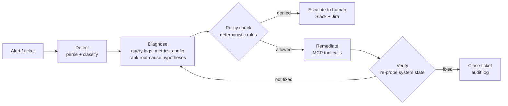

# Autonomous Remediation Agent + RemediationBench

**An LLM agent that resolves cloud incidents with a closed `detect → diagnose → policy-check → remediate → verify` loop, plus a small benchmark of Docker-sandboxed incidents graded by hidden state verifiers.**

> **Status: active development.** The architecture, task format and evaluation protocol below are fixed. Code is being built milestone by milestone (see [Roadmap](#roadmap)). The Results table is empty until runs are measured. No numbers here are estimates.

---

## Problem

Agents that operate real systems fail in a specific way. They find a *plausible* explanation for an incident, act on it, and declare success without checking that the system actually reached the right state. Recent IT-operations benchmarks report the same pattern: agents stop at a convincing root cause instead of verifying it.

For incident response this is the dangerous failure mode. A wrong "fix" that looks right is worse than no fix.

This project asks two questions:

1. **Agent:** Does an explicit *verify* stage, plus a deterministic policy gate before any write, measurably improve resolution rate and reduce harmful actions compared with a plain ReAct agent using the same tools?
2. **Benchmark:** Can we grade that fairly, on the **final state of the environment** rather than on the agent's transcript or an LLM judge?

## What's in the repo

| Component | What it does |
|---|---|
| `agent/` | The remediation agent: a 5-stage controller around an LLM, with tools exposed over MCP (SSE transport). |
| `policy/` | A deterministic policy engine (YAML rules) that every write action must pass: allow-lists, blast-radius limits, required approvals. |
| `tools/` | MCP tool servers for the (simulated) AWS control plane via LocalStack, logs/metrics queries, and Jira/Slack audit sinks. Real or mocked. |
| `bench/` | **RemediationBench**: incident tasks in Harbor task format, each with a hidden verifier that inspects final environment state. |
| `eval/` | Runner, metrics, and failure-taxonomy tooling: per-task traces, error categories, and comparison reports. |

## Architecture



**Key design decisions**

- **Verification is a stage, not a prompt.** After remediating, the agent must call read-only probe tools and compare the observed state with the success condition it stated *before* acting. If they disagree, the loop returns to diagnosis with the evidence attached, up to a step budget.
- **The policy gate is code, not the LLM.** Write tools are wrapped. The policy engine sees the tool name, arguments and target resources, and returns allow, deny or needs-approval. The LLM cannot talk its way past it.
- **Tools over MCP.** The agent only sees typed MCP tools (e.g. `describe_security_group`, `update_service_desired_count`, `query_logs`). The same agent can therefore run against LocalStack in the benchmark and against a real account later.
- **Everything is audited.** Every tool call, policy decision and verification result is appended to a structured JSONL trace and mirrored to Jira and Slack sinks.

## RemediationBench

Each task is a broken cloud environment plus a ticket describing symptoms, never the cause.

```
bench/tasks/s3-public-bucket-leak/
├── task.toml            # metadata, timeouts, resources
├── instruction.md       # the ticket the agent receives (symptoms only)
├── environment/
│   └── Dockerfile       # LocalStack + seed script that plants the fault
├── solution/
│   └── solve.sh         # oracle fix, used to validate the task is solvable
└── tests/
    └── test.sh          # HIDDEN verifier: inspects final state, writes reward
```

**Grading is on world state, not words.** `tests/test.sh` runs after the agent finishes and checks the environment. Examples: is the bucket policy private again, are the other buckets untouched, did the service return to its desired count? It writes a binary reward and a per-check breakdown. No LLM judge is involved.

**Planned task families** (first release: 20–30 tasks):

| Family | Example fault planted | Verifier checks |
|---|---|---|
| Access & IAM | Over-permissive bucket policy, leaked key | Resource private; *no unrelated resources modified* |
| Networking | Security group opened to `0.0.0.0/0` on 22 | Rule removed; required ingress still works |
| Compute | ECS/Lambda misconfig (env var, memory, desired count) | Service healthy; config matches spec |
| Storage | Lifecycle rule deleting live objects | Rule fixed; objects intact |
| Red herrings | Two plausible causes, only one real | Correct one fixed; decoy untouched |

Every task must pass with the oracle (`solve.sh` → reward 1) and fail with a no-op agent (reward 0) before it is admitted.

## Evaluation protocol

| Metric | Definition |
|---|---|
| **Resolution rate (pass@1)** | Fraction of tasks where the hidden verifier returns 1 |
| **Root-cause accuracy** | Agent's declared root cause matches the planted fault label |
| **Harmful-action rate** | Write actions that modified resources outside the fault scope, or were blocked by policy |
| **False-success rate** | Agent declared "resolved" but the verifier returned 0 (the failure this project targets) |
| **Cost** | Steps, tool calls and tokens per task |

**Ablations:** (a) plain ReAct with the same tools, (b) + policy gate, (c) + verify stage, (d) full system. The same model and step budget are used for each.

## Results

| Configuration | Pass@1 | Root-cause acc. | False-success | Harmful actions | Avg. steps |
|---|---|---|---|---|---|
| ReAct baseline | – | – | – | – | – |
| + Policy gate | – | – | – | – | – |
| + Verify stage | – | – | – | – | – |
| Full system | – | – | – | – | – |

*Filled in from `eval/reports/` once runs complete.*

## Tech stack

Python 3.11 · Model Context Protocol (Python SDK, SSE transport) · LocalStack (AWS emulation) · boto3 · Docker · Harbor (task format/runner) · FastAPI (webhook intake) · Jira & Slack APIs (audit sinks, mockable) · pytest

## Installation

```bash
git clone https://github.com/RoopanshuSD/cloud-remediation-agent.git
cd cloud-remediation-agent
python -m venv .venv && source .venv/bin/activate
pip install -e ".[dev]"
docker compose up -d localstack          # local AWS emulator
cp .env.example .env                     # LLM API key; Jira/Slack optional
```

## Usage

```bash
# run the agent on one incident
python -m agent.run --task bench/tasks/s3-public-bucket-leak

# run the full benchmark with an ablation config
python -m eval.run --config eval/configs/full.yaml --out eval/reports/full

# validate tasks (oracle must pass, no-op must fail)
python -m bench.validate bench/tasks/
```

## Roadmap

- [ ] M1: LocalStack environment + 5 tasks with oracle and hidden verifiers
- [ ] M2: MCP tool servers (read-only probes first, then wrapped write tools)
- [ ] M3: ReAct baseline agent + trace logging
- [ ] M4: Policy engine + verify stage
- [ ] M5: 20+ tasks incl. red-herring family; ablation runs; failure taxonomy write-up
- [ ] M6: Harbor-compatible export so tasks run with standard agent harnesses

## Limitations

- LocalStack emulates the AWS API, not AWS's real failure behaviour or latency.
- Small task count: results will have wide confidence intervals and are meant to compare configurations, not rank models.
- Root-cause labels are author-defined. Tasks with multiple valid fixes need verifier logic that accepts any valid end state.

## References

- Harbor framework: task format and runner, harborframework.com
- ITBench (IBM Research): benchmarking agents on IT automation tasks
- ITSMBench (Atomicwork × New Measure): state-verified ITSM tasks
- Yao et al., *ReAct: Synergizing Reasoning and Acting in Language Models*, 2022
- Model Context Protocol specification, modelcontextprotocol.io

## License

MIT
